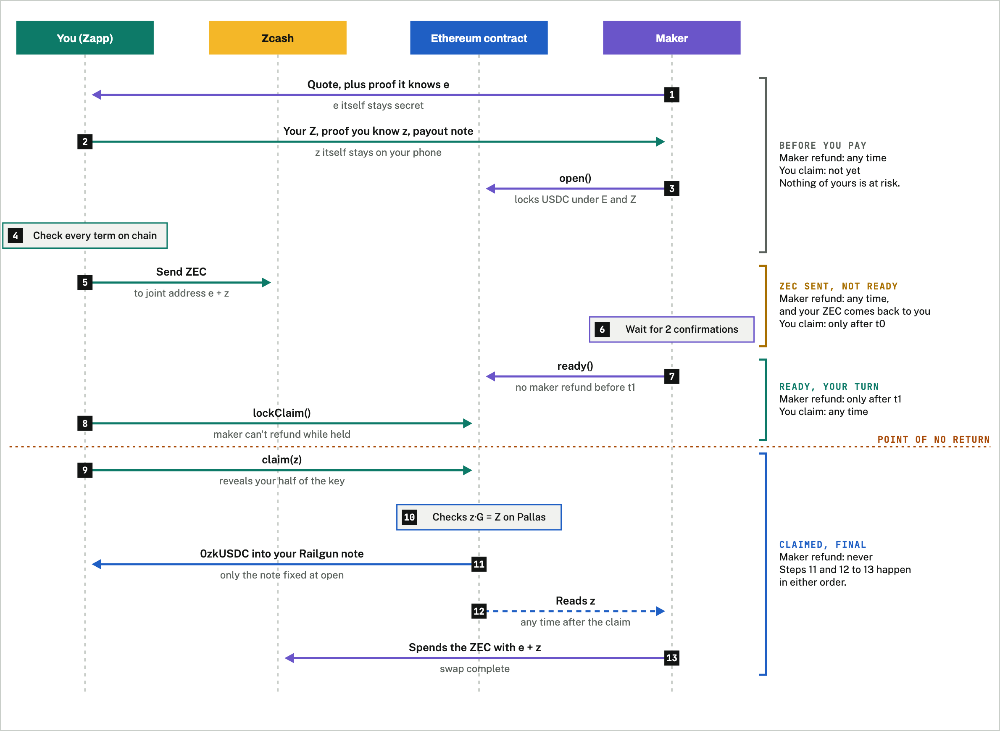

# ZecSwap

Non-custodial swaps of shielded ZEC for USDC on Ethereum, both ways, with the USDC held
privately in Railgun. The ZEC goes to an Ironwood address whose spend key is split between the
maker (`e`) and the user (`z`); an Ethereum contract pays out against whichever half is
revealed, verifying it on Pallas. Nothing touches a transparent address, no Ethereum account of the user's appears
on-chain, and nothing is custodied: every failure ends in a refund.

Running in beta on Ethereum mainnet:
[`0x4708D7d36992b7e33Ad97a1ab0A31c3ac6C4fe6D`](https://etherscan.io/address/0x4708D7d36992b7e33Ad97a1ab0A31c3ac6C4fe6D#code),
source verified on Etherscan.

## How a swap works

The normal path of a ZEC to USDC swap, start to finish.
[The full explainer](https://claude.ai/artifact/RY2zKsM5x7Yc1nyBn23gRg) adds the deadlines, the
locks, what happens when something goes wrong, and the USDC to ZEC direction.

<picture>
  <source media="(prefers-color-scheme: dark)" srcset="docs/images/swap-flow-dark.png">
  
</picture>

## Layout

| Path | What it is |
|---|---|
| `crates/zecswap-core` | Split-key primitives: joint account, proofs of knowledge, seed-derived shares, PCZT signing with `±(e + z)` |
| `crates/zecswap-chain` | Zcash light wallet (sync, joint accounts, sweeps) and the Ethereum contract client |
| `crates/zecswap-railgun` | Railgun keys, `0zk` addresses and the shield notes payouts go to, checked against Railgun's own engine |
| `crates/zecswap-api` | The maker's and relayer's APIs on the wire, shared by the services and wallets |
| `crates/zecswap-client` | The user side of a swap, step by step, as the wallet runs it |
| `crates/zecswap-maker` | Maker service: quote API, store, and the watchtower that settles every swap |
| `crates/zecswap-relayer` | Sends the transactions of users with no Ethereum account, on their signatures, and broadcasts their Railgun sends |
| `crates/zecswap-tokens`, `crates/zecswap-issuer` | Privacy Pass tokens that limit how many swaps a device can abandon a day, and the issuer that signs them for attested Android installs |
| `crates/zecswap-prices`, `crates/zecswap-alerts` | Prices for quotes and fees; Telegram alerts for the maker and relayer |
| `crates/zecswap-jni` | The Android wallet's bindings, built as `libzecswap.so` |
| `crates/zecswap-cli` | Test wallet and user CLI for testnets |
| `crates/zecswap-e2e` | Live end-to-end suite on Ethereum Sepolia and the Zcash testnet |
| `contracts` | `ZecSwap.sol` (two-phase lock-then-reveal state machine), `ShieldVault.sol` (per-swap Railgun payout vaults) and `Pallas.sol` (Foundry) |

The reverse Railgun-USDC-to-ZEC service, authorization flow, and Android integration boundary
are described in [the reverse flow guide](docs/reverse-flow.md).

## Tests

```sh
cargo test --workspace                     # crypto and policy edge cases, plus local Ironwood spends with real proofs
(cd contracts && forge test)               # contract unit, fuzz and invariant tests
cargo build --release -p zecswap-core --example evm_vectors
(cd contracts && FOUNDRY_PROFILE=ffi forge test)   # Pallas.sol fuzzed against the Rust implementation
scripts/e2e-testnet.sh --railgun [scenario ...]   # live testnets, about 25 minutes
```

The live suite deploys fresh contracts, runs an attentive and a silent maker in-process and
plays its scenarios concurrently, checking both chains at the end of each. Four pay into
Railgun (`railgun-happy`, `railgun-resume`, `railgun-no-deposit`, `railgun-send`) and six pay an
ordinary account: `happy` and five failures (`no-deposit`, `underpaid`, `silent-maker`,
`never-claimed`, `abandoned-claim`). It restarts the attentive maker partway through. It needs an Ethereum Sepolia key
with test ETH and a `zecswap-cli` wallet holding testnet ZEC; see the script for the variables.
Without `--railgun` it runs the contract's older account payouts on Base Sepolia instead.

```sh
cargo run -p zecswap-cli -- --data-dir .testnet/user init     # prints the address to fund
cargo run -p zecswap-cli -- --data-dir .testnet/user status
```

## Running a maker

```sh
cp crates/zecswap-maker/maker.example.toml maker.toml         # then fill in the addresses
MAKER_PRIVATE_KEY=... MAKER_ROOT_SECRET=... cargo run -p zecswap-maker -- --config maker.toml serve
```

Deploy the contract with `contracts/script/Deploy.s.sol`; [the deployment guide](docs/deployment.md)
covers the hosted maker, relayer and token issuer.
